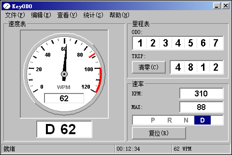
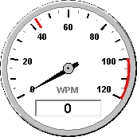

# KeyODO

键盘里程表 —— Windows 98 界面的原生 Win32 + GDI 桌面小工具。



统计按键次数与输入速度，界面严格复刻 `mockup/out/` 里的设计稿：经典灰色、3D 凹凸边框、
老式菜单栏、状态栏、GroupBox、汽车仪表盘。没有圆角、没有卡片、没有主题 API。

**只统计按键次数，不记录任何输入内容。**

---

## 快速开始

```cmd
build.cmd
```

产出：

* `build\keyodo.exe` —— 32 位原生程序（静态 CRT，无需任何运行库）
* `dist\KeyODO_Setup.exe` —— 安装程序

安装：

```cmd
dist\KeyODO_Setup.exe              :: 交互式安装（需要管理员权限）
dist\KeyODO_Setup.exe /S           :: 静默安装
dist\KeyODO_Setup.exe /S /D=C:\KeyODO
```

详见 [构建说明](docs/BUILD.md)。

---

## 功能（0.1）

| 项目 | 说明 |
|---|---|
| **ODO** | 累计真实按键次数，7 位前导零，退出时保存、下次启动恢复 |
| **TRIP** | 本次按键次数，可清零 |
| **WPM / KPM** | 实时速度，默认 10 秒滑动窗口；菜单「统计」可切换 5 / 10 / 30 秒 |
| **MAX** | 最高 WPM，同时以红色刻度线画在表盘上（峰值记忆） |
| **仪表盘** | 指针带指数平滑，不会一跳一跳 |
| **档位** | 自动挡 `P R N D` / 手动挡 `R N M1 M2 M3`，只显示当前变速模式相关的档位 |
| **读数模式** | 表盘内嵌读数与盘下读数可在 WPM / KPM 间切换（`Ctrl+K`） |
| **换挡显示** | 档位闸，当前档反白；R 档红色 |
| **桌面仪表** | 把速度表单独抽出来当桌面小组件悬浮显示（见下） |
| **分辨率与缩放** | 1080p / 2K / 4K 及 100%–200% 缩放，16:9 与 16:10 都能正确摆放（见下） |
| **自绘菜单** | 下拉菜单也是自绘的，不用系统 `TrackPopupMenu`，因此不会被主题化 |
| **总在最前** | 可选 |

读数模式、变速模式、窗口位置、桌面仪表的位置与开关、统计窗口长度都会随统计数据一起保存。

---

## 分辨率与缩放

窗口和桌面仪表的所有尺寸、字体、立体边框厚度都由 `src/ui/metrics.c` 按显示器 DPI 从
`include/keyodo_layout.h` 的 96 DPI 规格换算得出，**不是把界面位图拉伸**——4K 屏上文字是
按 200% 重新栅格化的，所以清晰而不是糊的。

实测（`tools/verify_resolution_matrix.py`，真实启动程序测量）：

| 缩放 | 主窗口 | 桌面仪表 |
|---|---|---|
| 100% | 480×320 | 184×184 |
| 125% | 600×400 | 230×230 |
| 150% | 720×480 | 276×276 |
| 200% | 960×640 | 368×368 |

10 种「分辨率 × 缩放 × 宽高比」组合（1080p / 2K / 4K × 16:9 / 16:10 × 常见缩放）全部
留有余量地放得下。

`tools/verify_scaling.py` 会逐个缩放级别启动程序、抓图，并确认：窗口尺寸精确成比例、
三个 GroupBox／表盘／状态栏的结构线都落在 `缩放倍数 × 96 DPI 位置`（误差 ≤1px）、
且画面与「100% 位图放大」明显不同（证明是重新绘制而非拉伸）。

跨显示器拖动时会收到 `WM_DPICHANGED` 并整体重新换算。程序按「每显示器 DPI 感知 v2」
申请，逐级回退到 v1、系统 DPI 感知，Windows 98 SE 上这些 API 都不存在则自然停在 96 DPI。

如果想让界面比系统缩放更大或更小：

```cmd
keyodo.exe --dpi=144
```

或写进 `keyodo.ini` 的 `[Window] Dpi`（0 = 跟随显示器）。

---

## 桌面仪表

菜单「查看 → 桌面仪表」可以把**速度表组件本身**单独抽出来，作为一个无边框小组件悬浮在
桌面上。它只画表盘：表圈、表盘面、刻度、数字、指针、峰值刻度线，以及表盘内嵌读数。
没有灰色方形面板、没有分组框、没有标题栏、没有菜单、没有其它读数。



* **窗口被裁成正圆**（`SetWindowRgn`），四个角是真正透明的，也是点击穿透的——
  点圆外不会误触小组件。没有用分层窗口（那是 Windows 2000 以后的东西），
  也没有用颜色键（会被系统主题撞色）。
* 拖动即可移动，位置自动保存
* 右键出菜单：显示主窗口 / 隐藏桌面仪表 / 退出
* 始终置顶，不出现在任务栏和 Alt+Tab 里（`WS_EX_TOOLWINDOW`）
* 直径随显示器 DPI 缩放：100% 下 172 px，200% 下 344 px
* 越界的位置会被拉回工作区，不会跑到屏幕外找不回来

### 指针的自然回落

打字停止后指针不是"挂"在读数上，而是像真车松油门那样滑落：

```
    t(s)   needle
     0.8    43.0  #####################
     1.6    29.0  ##############
     2.5    12.0  ######
     3.3     5.0  ##
     4.1     2.0  #
     4.9     0.5
```

原理：统计窗口是滑动窗口，如果只看窗口，停手后读数会**平着保持整个窗口长度**
再垂直掉下来。所以加了回落因子——安静超过 600 ms 后，读数按 900 ms 时间常数指数衰减。
600 ms 的宽限期是必要的：正常打字的间隔是 100–300 ms，短暂思考不能被当成停手。

指针本身的下落也比上升更"重"（上升 140 ms、下落 260 ms），这样看起来像带阻尼的表针
而不是线性斜坡。回落作用在速率本身上，所以指针、表盘内嵌读数、KPM 面板、状态栏
四个地方始终一致。`tools/needle_test.py` 直接从截图里量指针角度来验证这条曲线。

---

## 隐私

程序只接触**虚拟键码与扫描码**，不做键盘布局转换，不产生字符，不记录、不保存、不发送
任何输入内容。保存的 `keyodo.ini` 里只有计数器和显示设置。

---

## 架构

四个模块，互不感知，由 `src/app.c` 组装：

```
input/     键盘事件源        →  Raw Input（当前）/ 低级钩子（可切换）
stats/     计数与速率        →  ODO / TRIP / WPM / KPM / MAX / 档位
ui/        渲染              →  只画一份数据快照，不知道数据从哪来
storage/   持久化            →  只读写一条纯数据记录
```

**输入后端是可替换的**：`input/input.h` 定义了 `InputBackend` 接口，
`input.c` 负责选择。切换方式：

```cmd
keyodo.exe --input=hook        :: 或改 keyodo.ini 里的 [Input] Backend
```

两个后端都在 `tools/smoke_test.py` 下验证通过。将来要接 Windows 98 的
`WH_KEYBOARD` + DLL 方案，只需新增一个文件并在选择表里加一项，其它模块完全不动。

**界面模块不知道键盘存在**，统计模块不知道有窗口，存储模块不知道统计是什么。

详见 [构建说明 §6](docs/BUILD.md)。

---

## Windows 98 SE

源码是 Win98SE 兼容的：只用 ANSI API、不用 `GetWindowLongPtr` / 分层窗口 / 主题 API /
GDI+、不用 C99 特性、中文全部放在资源字符串表里（`.c`/`.h` 没有一个非 ASCII 字节）。

不过 **VS2022 编译出来的这个二进制跑不了 Win98SE**——现代 CRT 会引入 Win98 不存在的内核
导入。要出 Win98SE 的二进制，用当年的工具链重编即可，代码不用改：

```
MSVC 6.0 + Windows 98 SDK
```

细节见 [构建说明 §5](docs/BUILD.md)。

---

## 验证

```cmd
python tools\smoke_test.py --keys 20          :: 端到端：注入按键 → 计数 → 退出 → 检查持久化
python tools\capture_window.py                :: 抓取运行中的窗口
python tools\capture_window.py --widget       :: 抓取桌面仪表
python tools\compare_mockup.py                :: 与设计稿逐像素比对静态部分
python tools\verify_scaling.py                :: 100/125/150/200% 是否真的等比缩放
python tools\verify_resolution_matrix.py      :: 1080p/2K/4K × 16:9/16:10 是否放得下
python tools\widget_test.py                   :: 桌面仪表的圆形裁剪、位置、越界与持久化
python tools\needle_test.py                   :: 从截图量指针角度，验证回落曲线
python tools\installer_ui_test.py             :: 构建可非提权运行的副本并逐页截图安装向导
python tools\menu_test.py                     :: 下拉菜单的键盘导航、生效、取消与关闭
python tools\make_dial_icon.py                :: 用程序自己画的速度表生成 res/keyodo.ico
python tools\probe_rawinput.py                :: 独立验证 Raw Input 能否收到注入按键
```

`compare_mockup.py` 当前结果：外框、标题栏、菜单栏、三个 GroupBox 边框、表盘面板、
状态栏边框、两个按钮 —— 全部 0.00%，最大偏差 0.08%。

---

## 目录

| 路径 | 内容 |
|---|---|
| `src/` | 程序源码 |
| `res/` | 资源脚本、资源 ID、图标 |
| `include/keyodo_layout.h` | 布局常量（与设计稿同一组数字） |
| `installer/keyodo.nsi` | NSIS 安装脚本 |
| `build.cmd` | 一键构建 |
| `docs/BUILD.md` | 构建与安装说明 |
| `DESIGN.md` | 界面设计说明书（视觉规范） |
| `docs/COLOR.md` | 配色取值的证据与推导 |
| `mockup/` | 设计稿渲染器与输出 |
| `reports/` | 真实 GDI 图元的逐像素实测记录 |
| `tools/` | 构建期编码转换、验证与测试工具 |

---

## 界面设计是规范，不是产物

`DESIGN.md` 与 `mockup/out/` 是视觉规范，程序逻辑去适配界面，而不是反过来改界面。
`tools/compare_mockup.py` 就是这条约束的自动化检查。
